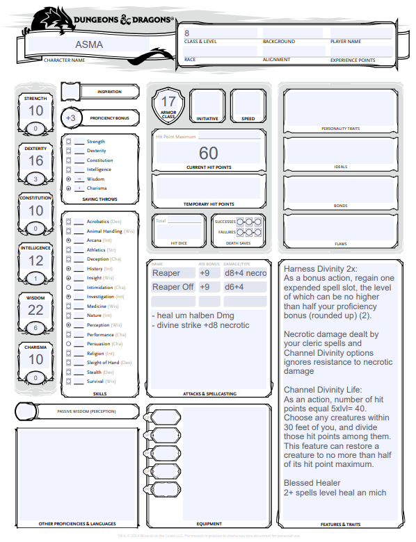

# Asma

4 3 3 2

# Slow

Source: Player's Handbook

*3rd-level transmutation*

**Casting Time:** 1 action

**Range:** 120 feet

**Components:** V, S, M (a drop of molasses)

**Duration:** Concentration, up to 1 minute

 40-foot cube within range. Wisdom saving throw

speed is halved, it takes a -2 penalty to AC and Dexterity saving throws, and it can’t use reactions. On its turn, it can use either an action or a bonus action, not both. Regardless of the creature’s abilities or magic items, it can’t make more than one melee or ranged attack during its turn.

If the creature attempts to cast a spell with a casting time of 1 action, roll a d20. On an 11 or higher, the spell doesn’t take effect until the creature’s next turn, and the creature must use its action on that turn to complete the spell. If it can’t, the spell is wasted.

A creature affected by this spell makes another Wisdom saving throw at the end of each of its turns. On a successful save, the effect ends for it.

# Sickening Radiance

Source: Xanathar's Guide to Everything

*4th-level evocation*

**Casting Time:** 1 action

**Range:** 120 feet

**Components:** V, S

**Duration:** Concentration, up to 10 minutes

 30-foot-radius sphere centered on a point you choose within range. 

When  moves into the spell’s area for the first time on a turn or starts turn , Constitution saving throw or take 4d10 radiant damage, and it suffers one level of exhaustion and emits a dim, greenish light in a 5-foot radius. This light makes it impossible for the creature to benefit from being invisible. The light and any levels of exhaustion caused by this spell go away when the spell ends.

| 1 | [Disadvantage](https://roll20.net/compendium/dnd5e/Rules:Ability%20Scores?expansion=34047#toc_2) on [ability checks](https://roll20.net/compendium/dnd5e/Rules:Ability%20Scores?expansion=34047#toc_4) |
| --- | --- |
| 2 | [Speed](https://roll20.net/compendium/dnd5e/Rules:Movement?expansion=34047#toc_1) halved |
| 3 | [Disadvantage](https://roll20.net/compendium/dnd5e/Rules:Ability%20Scores?expansion=34047#toc_2) on [attack rolls](https://roll20.net/compendium/dnd5e/Rules:Combat?expansion=34047#toc_32) and [saving throws](https://roll20.net/compendium/dnd5e/Rules:Ability%20Scores?expansion=34047#toc_35) |
| 4 | [Hit point](https://roll20.net/compendium/dnd5e/Rules:Combat?expansion=34047#toc_47) maximum halved |
| 5 | [Speed](https://roll20.net/compendium/dnd5e/Rules:Movement?expansion=34047#toc_1) reduced to 0 |
| 6 | Death |