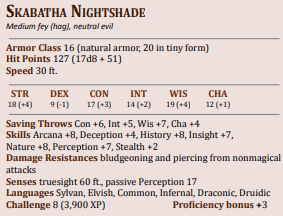

# Skabatha

[Phaerlax's alternative stats_notes for Skabatha Nightshade and tin soldiers + Skab's potions.pdf](Skabatha/Phaerlaxs_alternative_stats_notes_for_Skabatha_Nightshade_and_tin_soldiers__Skabs_potions.pdf)

Claw. Melee Weapon Attack: +7 to hit, reach 5 ft., one target. Hit: 9
(2d4 + 4) slashing. The
first time  DC 15 Wisdom saving throw. On a failure, it
becomes memory drained until it finishes a rest, or until
poison-cleansing magic like lesser restoration is cast on it.
While memory drained, the target must roll a d4 and subtract the
number rolled from any ability check or attack roll it makes. Each
time the target is memory drained beyond the first, the die size
increases by one: the d4 becomes a d6, the d6 becomes a d8, and
so on until the die becomes a d20, at which point the target
becomes stunned for 1 hour. The effect then ends.

Rewrite History (Recharge 6). 8 creatures she can see within 60ft. of her, and that are each within
20ft. of one another, DC 12
Intelligence saving throw or take 7 (2d6) psychic damage and be
riddled with false memories for 1 minute. 

At the end of each of its
turns, a creature can repeat the saving throw, ending the effect on
itself on a success. 

False memories have one of two effects, which
Skabatha chooses for each target:

**Paranoia**. The creature loses the ability to tell friend from foe.
Whenever the creature chooses another creature as a target, it
must choose the target at random from among the creatures it
can see within range of the attack, spell, or other ability it's using.
If an enemy provokes an opportunity attack from the affected
creature, it must make that attack if it is able to.
**Fondness**. The creature is charmed by Skabatha. Though it does
not forget any of her atrocious acts and is not compelled to obey
her, its mind is filled with memories of other moments in which
the hag was its kindly grandmother, and it is unable to harm her.

# Bestow Curse

*3 Necromancy*

- **Casting Time:** 1 action
- **Range:** Touch
- **Target:** A creature
- **Components:** V S
- **Duration:** Up to 1 minute
- You touch a creature, Wisdom saving throw or become cursed for the duration of the spell.
- ability score. disadvantage on ability checks and saving throws made with that ability score.
- disadvantage on attack rolls against you. Wisdom saving throw at the start of each of its turns. If it fails, it wastes its action that turn doing nothing.
- your attacks and spells deal an extra 1d8 necrotic damage to the target. A remove curse spell ends this effect. At the GM’s option, you may choose an alternative curse effect, but it should be no more powerful than those described above. The GM has final say on such a curse’s effect.

# Dispel Magic

*3 Abjuration*

- **Casting Time:** 1 action
- **Range:** 120 feet
- **Target:** One creature, object, or magical effect within range
- **Components:** V S
- **Duration:** Instantaneous

- Choose one creature, object, or magical effect within range. Any spell of 3rd level or lower on the target ends. For each spell of 4th level or higher on the target, make an ability check using your spellcasting ability. The DC equals 10 + the spell’s level. On a successful check, the spell ends.

# Black Tentacles Vines

*4 Conjuration*

- **Casting Time:** 1 action
- **Range:** 90 feet
- **Target:** A 20-foot square on ground that you can see within range
- **Components:** V S M (A piece of tentacle from a giant octopus or a giant squid)
- **Duration:** Up to 1 minute
- **Classes:** Wizard, Occultist, Spellblade
- 20-foot square on ground that you can see within range. For the duration, these tentacles turn the ground in the area into difficult terrain. When a creature enters the affected area for the first time on a turn or starts its turn there,  Dexterity saving throw or take 3d6 bludgeoning damage and be restrained until the spell ends. A creature that starts its turn in the area and is already restrained by the tentacles takes 3d6 bludgeoning damage .A creature restrained by the tentacles can use its action to make a Strength or Dexterity check (its choice) against your spell save DC. On a success, it frees itself.

# Incite Greed (dreams)

Source: Acquisitions Inc.

*3rd-level enchantment*

**Casting Time:** 1 action

**Range:** 30 feet

**Duration:** Concentration, up to 1 minute

choose any number of creatures within range that can see you. Wisdom saving throw or be charmed by you until the spell ends, or until you or your companions do anything harmful to it. While charmed in this way, a creature can do nothing but use its movement to approach you in a safe manner. While an affected creature is within 5 feet of you, it cannot move, but simply stares greedily at the gem you present.

At the end of each of its turns, Wisdom saving throw. If it succeeds, this effect ends for that target.

# Plant Growth

*3 Transmutation*

- **Casting Time:** 1 action
- **Range:** 150 feet
- **Target:** Plants within a specific area
- **Components:** V S
- **Duration:** Instantaneous
- **Classes:** Bard, Druid, Ranger, Occultist
- choose a point within range. All normal plants in a 100-foot radius centered on that point become thick and overgrown. A creature moving through the area must spend 4 feet of movement for every 1 foot it moves.

# Haste

Source: Player's Handbook

*3rd-level transmutation*

**Casting Time:** 1 action

**Range:** 30 feet

**Components:** V, S, M (a shaving of licorice root)

**Duration:** Concentration, up to 1 minute

 speed is doubled, +2 bonus to AC, it has advantage on Dexterity saving throws, and it gains an additional action on each of its turns. That action can be used only to take the Attack (one weapon attack only), Dash, Disengage, Hide, or Use an Object action.

When the spell ends, the target can’t move or take actions until after its next turn, as a wave of lethargy sweeps over it.

# Mind Blank (Pre Fight)

*8 Abjuration*

- **Casting Time:** 1 action
- **Range:** Touch
- **Target:** One willing creature you touch
- **Components:** V S
- **Duration:** 24 hours
- **Classes:** Bard, Wizard, Occultist
- Until the spell ends, one willing creature you touch is immune to psychic damage, any effect that would sense its emotions or read its thoughts, divination spells, and the charmed condition. The spell even foils wish spells and spells or effects of similar power used to affect the target’s mind or to gain information about the target.
- Lore Grund cursed von baba yaga

#