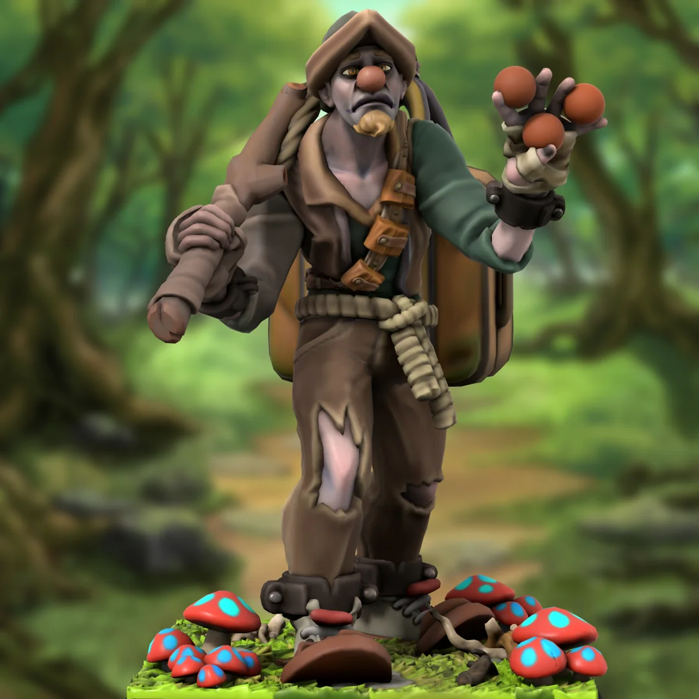

# Klaus, der klasse Clown

Ein dicker Gnom mit wenig Gedächtnis aber großem Enthusiasmus. Er bastelt Tiere aus Luftballons. Er würde am liebsten mehr Publikum und Freunde haben. Er ist einsam seit er gestorben ist. 

Er wird aggressiv und weint, falls jemand seine Tricks kritisiert oder seine Witze nicht gut ankommen.

AC 15
HP 45
STR -1
DEX +2
CON 0
INT +1
WIS 0
CHA +3

Immune to charms and poison
Vulnerable to psychic damage, especially fear

Action:
Wasserballons: +5, 60ft, 2d6 Acid Damage, CON save bei Splash und Anfang jeder Runde ansonsten 1d4 poison zu Beginn der Runde des Gegners